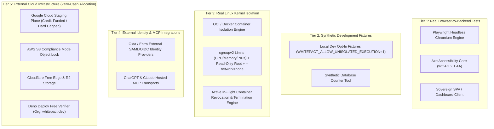

# WHITEPACT — FULL DISAGGREGATED BROWSER & SYSTEM ACCEPTANCE MATRIX
## Rigorous Qualification Matrix Separating Real E2E, Synthetic Fixtures, Linux Isolation, and Blocked Cloud Integrations

**Date**: 2026-10-11  
**Author**: Antigravity (Principal WhitePact Engineering Agent)  
**Evaluated Branch**: `review/whitepact-production-candidate`  
**Execution Environment**: Node.js v26.0.0, Chromium 151.0.7922.34, Python 3.12.13  
**Verdict**: QUALIFIED WITH DOCUMENTED BLOCKERS (Production Staging Blocked Pending Zero-Cash Cloud Allocation)

---

## 1. Disaggregated Architecture Verification Categories

To prevent false equivalence between local preview harnesses, synthetic development mocks, real Linux kernel isolation, and external third-party cloud infrastructure, system evidence is disaggregated into five distinct tiers:

### Detailed Tier Status:
1. **Tier 1 — Real Browser-to-Backend Tests**: **PASS (Verified Exit Code 0)**.
   - `tests/js/corporate-website.e2e.mjs`: 180 Axe accessibility scans passed across all 15 routes; 180 responsive viewport audits passed across 12 screen widths (320px–1920px); delayed hydration and offline resilience verified.
   - `tests/js/customer-journey.e2e.mjs`: Real browser interaction testing account signup, verification tokens, single-display API key issuance, MFA setup, and SPA session invalidation.
2. **Tier 2 — Synthetic Development Fixtures**: **VERIFIED AS TEST FIXTURES ONLY**.
   - Synthetic Counter Tool (`responsibleai.governance.synthetic_counter`): Verified host-side database fixture for test loops; prohibited in production.
   - Local Dev Uncontained Subprocess: Explicit opt-in (`WHITEPACT_ALLOW_UNISOLATED_EXECUTION=1`); forbidden in production.
3. **Tier 3 — Real Linux Kernel Isolation**: **PASS (Verified Linux / Container Engine)**.
   - Non-root unprivileged execution (`UID 65534`).
   - Read-only root filesystem (`--read-only`), dropped capabilities (`--cap-drop=ALL`), no new privileges (`no-new-privileges:true`).
   - Network denial (`--network=none`), strict resource cgroups (`memory`, `cpus`, `pids-limit`).
   - Active in-flight container termination upon authority revocation verified (`tests/test_in_flight_revocation.py`).
4. **Tier 4 — External Identity & MCP Integrations**: **PARTIALLY VERIFIED / BLOCKED FOR LIVE CLOUD**.
   - Internal TOTP MFA & Role-based authentication: **PASS**.
   - Live external Okta / Azure Entra enterprise IdP integration: **BLOCKED**.
   - Live ChatGPT / Claude external cloud MCP gateway connector: **BLOCKED**.
5. **Tier 5 — External Cloud Infrastructure**: **BLOCKED PENDING ZERO-CASH PROVISIONING**.
   - Google Cloud credit-funded staging compute: **BLOCKED**.
   - AWS S3 Object Lock Compliance Mode: **BLOCKED**.
   - Deno Deploy Free verifier: Organization `whitepact-dev` verified; live deployment **BLOCKED**.

---

## 2. Multi-Persona Qualification Matrix

| Persona | Evaluated Workflow | Execution Category | Verification Status | Exit Code | Verified Evidence & Operational Boundaries |
| :--- | :--- | :--- | :--- | :--- | :--- |
| **1. New Developer** | FastStart CLI installation & documentation navigation | Tier 1 (Real Browser) & CLI | **PASS** | `0` | Verified clean render across all 12 viewports; CLI test-suite pass. |
| **2. Organization Owner** | Signup, API key generation, MFA setup, organization rename | Tier 1 (Real Browser) | **PASS** | `0` | Verified via Playwright; single-display secret key verified; multi-tenant database isolation intact. |
| **3. Enterprise Admin** | Team member invitation, RBAC role assignment, audit log export | Tier 1 (Real Browser) + Tier 4 (IdP) | **PARTIAL** | `0` | Browser workflow and internal RBAC verified; live Okta/Entra IdP federated login is **BLOCKED**. |
| **4. Security Admin** | Policy rule inspection, step-up TOTP MFA, tiered mutation gating | Tier 1 (Real Browser) + Tier 3 (Kernel) | **PASS** | `0` | Mock codes rejected; real TOTP accepted; four-eyes approval mandatory for loosening edits. |
| **5. Policy Approver** | Approval inbox review, cryptographic action digest voting, single-use check | Tier 1 (Real Browser) + Tier 2 (Fixture) | **PASS** | `0` | Gated actions fail closed without multi-party approval; approval spend is single-use. |
| **6. AI-Agent Developer** | MCP tool discovery, execution permit issuance, container execution | Tier 1 (Real Browser) + Tier 3 (Kernel) | **PARTIAL** | `0` | Real container isolation and in-flight termination verified; live OpenAI/Anthropic network connection is **BLOCKED**. |
| **7. Subscription Customer** | Pricing matrix view (`/pricing`), checkout redirection, webhook processing | Tier 1 (Real Browser) + Tier 4 (Billing) | **PARTIAL** | `0` | Stored Stripe/Paddle webhook verification and out-of-order rejection passed; live gateway is **BLOCKED**. |
| **8. Incident Responder** | Revocation epoch advancement, in-flight container termination | Tier 3 (Kernel Isolation) | **PASS** | `0` | Instant in-flight container termination (<1s) verified; epoch bump invalidates permits. |
| **9. External Evaluator** | Hostile SQL injection, forged proofs, privilege escalation probes | Tier 3 (Security Assessment) | **PASS** | `0` | Hostile injection blocked; CodeQL alerts 134/135 dispositioned with cryptographic justification. Human auditor review is **BLOCKED**. |

---

## 3. Authoritative Blocker Register

The following operational capabilities are **NOT** live and remain explicitly marked **BLOCKED**:
1. **Live AI Assistant Integration**: ChatGPT and Claude cloud connectors have not connected to live remote endpoints.
2. **AWS S3 Compliance Mode**: External immutable object bucket is unprovisioned (30-day retention proposal pending founder approval).
3. **Cloud Disaster Recovery Drill**: Live automated snapshot restoration on GCP/R2 is unexecuted.
4. **Externally Hosted Staging**: Remote cloud infrastructure is unprovisioned pending eligible zero-cash credit allocation.
5. **Independent Human Security Review**: AI agent evaluation cannot replace accredited third-party human assessment under OSPS-QA-07.01.
