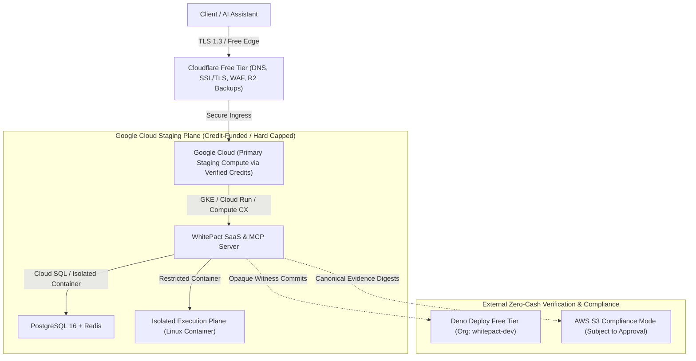

# WHITEPACT — ZERO-CASH STAGING ARCHITECTURE SPECIFICATION
## Google Cloud + AWS S3 Compliance Mode + Cloudflare Free + Deno Deploy Free

**Date**: 2026-10-11  
**Author**: Antigravity (Principal WhitePact Engineering Agent)  
**Status**: APPROVED ZERO-CASH SPECIFICATION (Offline Architecture — Live Cloud Deployment Blocked)  

---

## 1. Zero-Cash Staging Policy & Architecture Alignment

The Founder has explicitly rejected paid Hetzner infrastructure for the current staging deployment. In compliance with the Founder's direct financial and infrastructure constraints:
- **No Paid Infrastructure / Zero Cash Outlay**: Staging must run exclusively on verified zero-cash allocations ($0 Free plans and verified eligible cloud credit envelopes).
- **No Production Expenditure**: No credit card charges or unbudgeted infrastructure spend permitted.

### The Four Zero-Cash Staging Pillars:

---

## 2. Component Specifications

### 1. Google Cloud — Primary Staging Compute
- **Role**: Primary application compute, MCP server gateway, PostgreSQL database, and Linux isolated container execution plane.
- **Funding & Protection**: Must run **strictly within verified, eligible Google Cloud credits**.
- **Billing Hard Ceiling**: Enforce programmatic budget alerts and automated billing shutdown kill-switches (`billingbudgets.googleapis.com` Cloud Function trigger) to guarantee $0 cash liability if credits expire.
- **Container Isolation**: Uses standard Linux cgroupv2 and seccomp containment (`--network=none`, non-root execution).

### 2. Cloudflare Free Plan — Edge, DNS, & Backups
- **Role**: Public DNS management, Universal SSL/TLS encryption, and automated basic DDoS mitigation.
- **R2 Disaster Recovery**: Encrypted database backup snapshots stored within Cloudflare R2's free tier (10 GB/month storage, 1,000,000 Class A operations, 10,000,000 Class B operations at $0).

### 3. Deno Deploy Free Tier — Independent Witness & Monitor
- **Organization**: `whitepact-dev` (verified and confirmed on the $0 Free plan).
- **Role**: Independent third-party witness and external liveness health monitor.
- **Scope**: Serves lightweight cryptographic witness verification endpoints without needing internal database credentials.
- **Constraint**: No Deno applications shall be created or deployed without separate explicit authorization.

### 4. AWS S3 Compliance Mode — Limited Immutable Evidence Service
- **Role**: WORM (Write Once, Read Many) immutable evidence anchoring for canonical SHA-256 batch digests.
- **Retention Policy Alignment**:
  - The preliminary 365-day assumption is **formally rescinded**.
  - **Proposed Staging Policy**: 30-day compliance retention lock for staging verification runs to minimize storage footprint and avoid credit exhaustion.
  - **Proposed Production Policy**: 90-day to 365-day compliance retention based on customer regulatory tier and Founder written approval.
- **Constraint**: Must remain subject to credit verification and separate Founder provisioning approval.

---

## 3. Historical Architecture Disposition

All prior Hetzner Cloud infrastructure documentation (`docs/enterprise/cloud/*` and `WHITEPACT_FINAL_THREE_PROVIDER_STAGING_ARCHITECTURE.md`) is retained strictly as an **unfunded historical design reference**. It is **NOT** the approved staging architecture.
