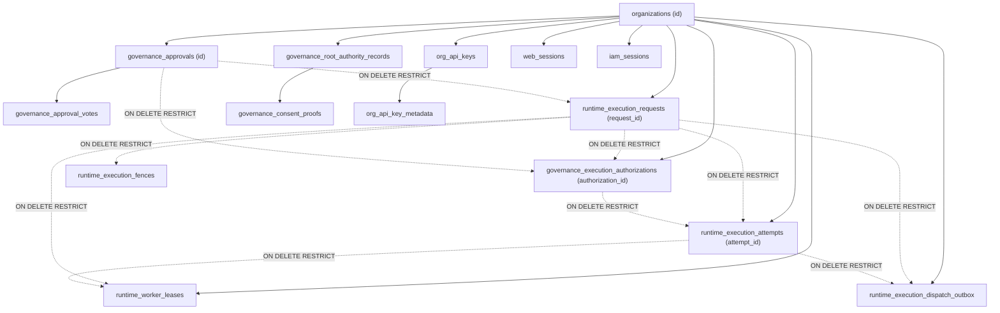

# M13-H4 POSTGRESQL FOREIGN KEY MATRIX AND TOPOLOGICAL PURGE SPECIFICATION
**Subsystem:** H4 Backup, Disaster Recovery & Authority Reconciliation  
**Target:** Operation M13 Recovery Zero  
**Date:** 2026-10-19  
**Security Classification:** P0 Critical  
**Author:** Antigravity FORTRESS Lead  

---

## 1. Schema Catalog Dependency Graph

The relational dependency graph below was extracted directly from the PostgreSQL 16 `information_schema` catalog on the canonical Alembic migration baseline.

---

## 2. Table Dependency, Classification & Lifecycle Action Matrix

| Table Name | Classification | Invariant & On-Delete Behavior | Action on Tombstone | Ordering Step |
|---|---|---|---|---|
| `runtime_worker_leases` | Operational Infrastructure | References `attempt_id`, `request_id`, `org_id` (`RESTRICT`). | **DELETED** | Step 1 |
| `runtime_execution_dispatch_outbox` | Operational Infrastructure | References `attempt_id`, `request_id`, `org_id` (`RESTRICT`). | **DELETED** | Step 2 |
| `runtime_execution_fences` | Operational Infrastructure | References `request_id` (`RESTRICT`). | **DELETED** | Step 3 |
| `runtime_execution_attempts` | Operational Execution | References `auth_id`, `request_id`, `org_id` (`RESTRICT`). | **DELETED** | Step 4 |
| `governance_execution_authorizations` | Operational Authority | References `request_id`, `approval_id`, `org_id` (`RESTRICT`). | **DELETED** | Step 5 |
| `runtime_execution_requests` | Historical Audit Evidence | **Trigger `prevent_execution_request_mutation` blocks UPDATE/DELETE.** References `approval_id` (`RESTRICT`). | **PRESERVED** (Immutable) | N/A |
| `governance_approvals` (Referenced) | Audit & Operational Evidence | Referenced by `runtime_execution_requests.approval_id`. Cannot delete without FK violation. | **REVOKED** (`status='REVOKED'`) | Step 6a |
| `governance_approvals` (Unreferenced) | Operational Authority | Not referenced by any immutable request row. | **DELETED** | Step 6b |
| `governance_approval_votes` | Quorum Evidence | Associated with approvals. Deleted only for unreferenced approvals. | **DELETED** (if unreferenced) | Step 6c |
| `governance_policy_activations` | Operational Governance | References `revisions.id` and `org_id`. | **DELETED** | Step 7 |
| `governance_policy_revisions` | Governance Hierarchy | References `org_id`. | **DELETED** | Step 8 |
| `governance_policy_versions` | Governance Hierarchy | Scoped to org. | **DELETED** | Step 9 |
| `governance_policies` | Governance Root | Scoped to org. | **DELETED** | Step 10 |
| `governance_policy_history` | Historical Audit | Scoped to org. | **DELETED** | Step 11 |
| `governance_execution_nonces` | Operational Authority | One-time replay nonces. | **DELETED** | Step 12 |
| `governance_delegations` | Operational Authority | Inter-tenant or agent delegations. | **DELETED** | Step 13 |
| `org_api_key_metadata` | Credential Metadata | Child of `org_api_keys` (`CASCADE`). | **DELETED** | Step 14 |
| `org_api_keys` | Operational Credential | API authentication keys. | **DELETED** | Step 15 |
| `iam_api_key_lineage` | Lineage Audit | Key lineage records. | **DELETED** | Step 16 |
| `web_sessions` | Operational Credential | User interactive sessions (`CASCADE`). | **DELETED** | Step 17 |
| `iam_sessions` | Operational Credential | IAM operational sessions (`RESTRICT`). | **DELETED** | Step 18 |
| `eval_runs` / `eval_baselines` | Operational Evaluations | Evaluation tracking. | **DELETED** | Step 19 |
| `mcp_tool_calls` | Operational Tool State | Tool invocation states. | **DELETED** | Step 20 |
| `token_usage` | Accounting Metrics | Metering metrics. | **DELETED** | Step 21 |
| `iam_scim_users` / `groups` | Identity Federation | SCIM identity mappings. | **DELETED** | Step 22 |
| `web_memberships` | Membership Authority | User-to-org memberships (`CASCADE`). | **DELETED** | Step 23 |
| `governance_root_authority_records` | Root Trust Anchor | Legal audit evidence and root key anchoring. | **REVOKED** (`revoked_at=now`) | Step 24 |
| `governance_consent_proofs` | Consent Evidence | Proof of user consent referencing root authority. | **REVOKED** (`revoked_at=now`) | Step 25 |
| `organizations` | Tenant Anchor | Primary tenant entity. | **TRANSFORMED / QUARANTINED** (`governance_status='DISABLED'`) | Step 26 |

---

## 3. Strict Topological Cascade Execution Order

The cascade deletion sequence in `reconcile_post_restore()` strictly follows the directed acyclic graph (DAG) from leaves to parents:

1. **Delete Outbox and Leases:** `runtime_worker_leases` and `runtime_execution_dispatch_outbox` are removed first, unblocking references to `runtime_execution_attempts`.
2. **Delete Fences:** `runtime_execution_fences` removed.
3. **Delete Attempts:** `runtime_execution_attempts` removed, unblocking references to `governance_execution_authorizations`.
4. **Delete Execution Authorizations:** `governance_execution_authorizations` removed, severing active authorization ties to `governance_approvals`.
5. **Partition and Handle Approvals:**
   - Query all `runtime_execution_requests.approval_id` for the tenant.
   - For referenced approvals: update `status='REVOKED'`, `resolved_by=reconciled_by`, `resolved_at=now()`. No FK violation occurs on `runtime_execution_requests`.
   - For unreferenced approvals: delete associated `governance_approval_votes`, then delete the unreferenced `governance_approvals`.
6. **Cascade Policy and IAM Purge:** Policy activations down to policies, nonces, delegations, API keys, and sessions are purged.
7. **Forensic Neutralization of Root Records:**
   - `governance_root_authority_records` and `governance_consent_proofs` are NOT deleted. Deleting them violates self-referencing foreign keys and breaks legal retention obligations.
   - Instead, both tables are forensically revoked by updating `revoked_at = now()`, `revoked_by = reconciled_by`. Any downstream verifier seeing `revoked_at IS NOT NULL` unconditionally rejects authority.
8. **Tenant Quarantine:** `organizations.governance_status` is updated to `'DISABLED'` (satisfying the PostgreSQL check constraint `chk_org_governance_status`), and `deactivated_at = now()`.

---

## 4. Verification Proof

Both the independent reproducer test `test_tombstone_reconciliation_handles_real_approval_request_fk` and adversarial test suite execute this exact topological cascade against real PostgreSQL 16 without foreign key violations or trigger rejections.
