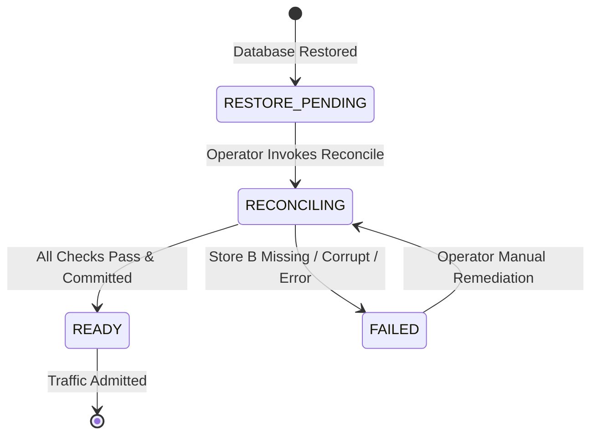

# M13-H4 CANONICAL STORE B AUTHORITY AND FENCING SPECIFICATION
**Subsystem:** H4 Backup, Disaster Recovery & Authority Reconciliation  
**Target:** Operation M13 Recovery Zero  
**Date:** 2026-10-19  
**Security Classification:** P0 Critical  
**Author:** Antigravity FORTRESS Lead  

---

## 1. Architectural Authority Model

WhitePact operates an asymmetric dual-store authority model to guarantee that database restoration (Store A recovery) can never resurrect revoked or expired execution authority.

```
+-------------------------------------------------------------+
|                 STORE B: DURABLE LIFECYCLE                  |
|  - Independent durable control plane / consensus log        |
|  - Cryptographically signed tenant lifecycle states         |
|  - Authoritative monotonic security_epoch & revocation_floor|
|  - Immutable tombstone registry                             |
+-------------------------------------------------------------+
                              |
               Post-Restore Reconciliation
                              v
+-------------------------------------------------------------+
|               STORE A: RELATIONAL OPERATIONAL DB             |
|  - PostgreSQL 16 operational tables                         |
|  - Restored from point-in-time snapshot (potentially stale) |
|  - Revocation epochs: governance_revocation_epochs          |
|  - Approvals, executions, web sessions, API keys            |
+-------------------------------------------------------------+
                              |
                     Runtime Execution
                              v
+-------------------------------------------------------------+
|                    EXECUTION VERIFIERS                      |
|  - Validates: token.issuer_epoch == db.current_epoch        |
|  - Invariant: Restored DB epoch >= Store B revocation_floor |
+-------------------------------------------------------------+
```

### 1.1 Store B Authority Invariant
Store B is the sole authoritative source of tenant lifecycle transitions (Active, Suspended, Quarantined, Tombstoned) and the global revocation epoch floor. 

Store A contains point-in-time operational data. By definition, a restored database snapshot from time $T_{backup}$ does not reflect security events (credential revocations, membership terminations, tenant deletions, epoch bumps) occurring between $T_{backup}$ and $T_{restore}$.

---

## 2. Namespace & Epoch Disambiguation Matrix

A critical source of past vulnerabilities was conflating distinct epoch namespaces. WhitePact formalizes the following distinct security namespaces:

| Namespace | Store / Table | Scope / Column | Verifier Usage | Monotonicity Rule |
|---|---|---|---|---|
| **Store B Security Epoch** | Store B Ledger | `security_epoch` | Dictates minimum allowable epoch across all services | Monotonically non-decreasing integer |
| **Store B Revocation Floor** | Store B Ledger | `revocation_floor` | Absolute lower bound for operational admission | Monotonically non-decreasing integer |
| **Canonical Governance Epoch** | Store A: `governance_revocation_epochs` | `scope='governance'` | Checked by `RevocationEpochRepository.current()` and `InFlightExecutionRegistry` | Must be $\ge \max(epoch_{current}, floor_{StoreB})$ |
| **Tenant-Global Epoch** | Store A: `governance_revocation_epochs` | `scope='tenant_global'` | Checked by organization-wide tenant fences | Must be $\ge \max(epoch_{current}, floor_{StoreB})$ |
| **Oneshot Authority Epoch** | Store A: `governance_execution_authorizations` | `issuer_epoch` | Checked at execution attempt admission | Denied if $issuer\_epoch < current\_epoch$ |
| **Approval Observed Epoch** | Store A: `governance_approvals` | `revocation_epoch` | Bound to approval quorum issuance | Invalidated if current epoch exceeds approval epoch |
| **Request Observed Epoch** | Store A: `runtime_execution_requests` | `observed_governance_epoch` | Immutable audit evidence | Bound at request registration |

---

## 3. Post-Restore Monotonic Fencing Algorithm

### 3.1 Elimination of Arbitrary Constants
Legacy implementations attempted to ensure freshness using heuristics such as `max(epoch + 1000, 999999)`. This was rejected by Codex integration review because:
1. It broke determinism and finite state modeling.
2. It failed to track the actual authoritative Store B floor.
3. It created overflow hazards and simulated security without mathematical proof.

### 3.2 Formal Monotonic Fencing Specification
For each tenant $T$ present in Store A upon restoration:

1. **Query Store B:** Retrieve the authoritative lifecycle record $L_B(T)$.
2. **If $L_B(T)$ does not exist or is corrupted:**
   - The tenant CANNOT be validated.
   - Fail-closed rule: Tenant is quarantined with `governance_status = 'DISABLED'`.
   - Gate transitions to `RestoreReadinessState.FAILED`.
   - Consequential execution is blocked until authenticated operator reconciliation.
3. **If $L_B(T).state == \text{TOMBSTONED}$:**
   - Mark organization as quarantined: `governance_status = 'DISABLED'`, suffix name `-RESTORE_QUARANTINED`.
   - Purge or neutralize all active operational authority (see PostgreSQL FK Matrix).
   - Set both `scope="governance"` and `scope="tenant_global"` epochs to:
     $$\text{Epoch}_{target} = \max(\text{Epoch}_{current} + 1, L_B(T).\text{revocation\_floor}, L_B(T).\text{security\_epoch})$$
4. **If $L_B(T).state == \text{ACTIVE}$:**
   - Determine the effective floor:
     $$\text{Floor}_{B} = \max(L_B(T).\text{revocation\_floor}, L_B(T).\text{security\_epoch})$$
   - For every scope $S \in \{\text{"governance"}, \text{"tenant\_global"}\}$:
     $$\text{Epoch}_{new} = \max(\text{Epoch}_{current}, \text{Floor}_{B})$$
   - If $\text{Epoch}_{current} < \text{Floor}_{B}$, atomically update Store A with $\text{Epoch}_{new}$.

### 3.3 Verifier Acceptance Proof
Because execution admission requires:
$$\text{token.issuer\_epoch} == \text{db.current\_epoch}$$
Any token issued before $T_{restore}$ has $\text{token.issuer\_epoch} \le \text{Floor}_{B} - 1$ (or $< \text{Epoch}_{target}$ in the case of tombstones). Consequently:
$$\text{token.issuer\_epoch} < \text{db.current\_epoch} \implies \text{ADMISSION DENIED}$$
No restored token, key, or grant can ever bypass the fencing verification.

---

## 4. State Transitions and Gate Invariants



- When the gate is in `RESTORE_PENDING`, `RECONCILING`, or `FAILED`, `assert_restore_readiness_admitted()` raises `RestoreQuarantineError`.
- No operational traffic or consequential execution is admitted until the transaction commits cleanly and state advances to `READY`.
