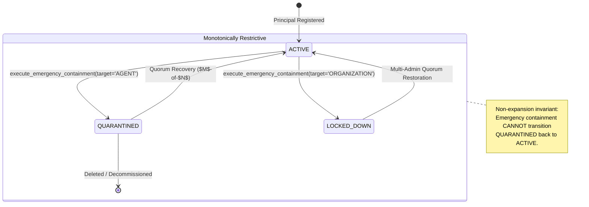

# WHITEPACT — EMERGENCY CONTAINMENT THREAT MODEL & NON-EXPANSION INVARIANT
## Milestone M12-FS Deliverable 5: Single-Owner Emergency Kill-Switch Architecture

**Classification:** Critical Security Threat Model & Control Design  
**Milestone:** M12-FS (Founder Security Policy Implementation & Root-of-Trust Hardening)  
**Author:** Antigravity — Principal Security Architect & Runtime Qualification Lead  
**Reviewer:** GPT-6 — CTO / Security Review Coordinator  
**Status:** IMPLEMENTED & TESTED (Release Gate: GLOBAL PRODUCTION NO-GO)  

---

### 1. FOUNDER DECISION B ARCHITECTURAL RATIONALE

**Founder Decision B** formally establishes an asymmetric security boundary between emergency containment and authority restoration:

> **"Properly authorized emergency containment may proceed without multi-admin quorum. High-assurance root transfer and recovery require multi-admin quorum."**

#### The Asymmetric Latency Problem
In an active security incident (e.g. compromised agent credential, anomalous exfiltration loop, prompt injection exploit, or rogue workflow), the mean time to respond (MTTR) must be bounded by seconds, not hours. Requiring multi-admin quorum ($M$-of-$N$ signatures or approvals) to execute an emergency shutdown introduces catastrophic latency:
- Administrators may be offline, in different time zones, or unreachable.
- Adversarial agents or attackers can complete destructive operations while quorum is pending.
- Quorum mechanisms themselves may be subject to availability disruption during an attack.

Therefore, emergency containment is designed as an immediate, single-authorized-owner kill-switch.

---

### 2. THE NON-EXPANSION INVARIANT

To prevent single-admin kill-switches from becoming a vector for privilege escalation or lateral movement, WhitePact enforces the **Non-Expansion Invariant**:

$$\Delta \text{Authority}(\text{Containment}) \le 0$$

An emergency containment action can **ONLY**:
1. Revoke active execution grants or delegations.
2. Advance the organization or principal security epoch ($\text{epoch} \leftarrow \text{epoch} + 1$).
3. Transition an agent or principal to `QUARANTINED` state.
4. Transition an organization to `LOCKED_DOWN` state.
5. Invalidate existing TLS/WebSocket sessions and egress tokens.

An emergency containment action can **NEVER**:
- Grant new capabilities, permissions, or delegations.
- Re-activate quarantined or revoked principals.
- Overwrite or substitute canonical root authority.
- Downgrade security policies or bypass audit logging.
- Clear containment audit trails.

Once applied, the state change is strictly monotonically restrictive. Restoring authority from containment requires either manual administrative intervention or high-assurance quorum recovery (Founder Decision B).

---

### 3. THREAT VECTOR ANALYSIS & MITIGATIONS

| Threat Vector | Adversary Goal | WhitePact Mitigation & Mechanical Proof |
| :--- | :--- | :--- |
| **Rogue Admin DoS** | Malicious or disgruntled admin triggers emergency containment to disrupt enterprise business operations. | **Mitigation:** Containment is restricted to verified Organization Admins (`membership_status == 'ACTIVE'`). Every containment event logs a cryptographically immutable record in `authority_containment_records` with actor ID, timestamp, target type, target ID, and reason. Quorum recovery ($M$-of-$N$) allows unaffected admins to recover the tenant. |
| **Unauthorized Caller** | Non-admin or cross-tenant actor attempts to call `/containment/emergency`. | **Mitigation:** Enforced in `execute_emergency_containment()`: caller must be `OWNER` or `ADMIN` in the specific target organization. Cross-tenant or unauthenticated callers receive `CONTAINMENT_FORBIDDEN` (HTTP 403). Verified in `test_containment_rejects_unauthorized_caller`. |
| **Target Tampering** | Attacker specifies invalid or non-existent target types to trigger unhandled exceptions or state corruptions. | **Mitigation:** Strict target type validation (`AGENT`, `ORGANIZATION`, `ROOT`). Target must exist within the caller's organization. Mismatches fail with `CONTAINMENT_INVALID_TARGET` (HTTP 400). |
| **Residual Execution Race** | Agent continues executing in-flight tasks after containment is triggered. | **Mitigation:** Atomic database transaction: updates `principals` table (`state = 'QUARANTINED'`), increments `epoch`, and commits before returning. All downstream policy checks verify `epoch` and reject any grant issued under older epochs. Verified in `test_emergency_agent_containment_quarantines_and_bumps_epoch`. |
| **Egress Token Survival** | Network egress proxy permits outbound requests with pre-issued tokens. | **Mitigation:** Socket peer pinning and epoch invalidation; the egress gateway checks the principal epoch and active revocation list on every outbound TLS connection attempt. |

---

### 4. DATA MODEL & STATE TRANSITIONS



#### Containment Record Schema (`authority_containment_records`)
```sql
CREATE TABLE IF NOT EXISTS authority_containment_records (
    containment_id VARCHAR(128) PRIMARY KEY,
    organization_id VARCHAR(128) NOT NULL,
    actor_id VARCHAR(128) NOT NULL,
    target_type VARCHAR(64) NOT NULL,
    target_id VARCHAR(128) NOT NULL,
    reason TEXT NOT NULL,
    status VARCHAR(64) NOT NULL,
    contained_at TIMESTAMPTZ NOT NULL,
    metadata JSONB NOT NULL DEFAULT '{}'
);
CREATE INDEX IF NOT EXISTS idx_containment_org ON authority_containment_records(organization_id);
```

---

### 5. ADVERSARIAL TEST EVIDENCE

Automated verification in `tests/test_m12fs_root_hardening.py`:
- `test_emergency_agent_containment_quarantines_and_bumps_epoch`: Confirms agent state changes to `QUARANTINED`, epoch bumps from `1` to `2`, and audit row is recorded.
- `test_emergency_organization_lockdown`: Confirms organization-level kill switch locks down organization and bumps global organization security epoch.
- `test_containment_rejects_unauthorized_caller`: Proves unprivileged members cannot execute containment.

---

### 6. RELEASE GATE DIRECTIVE

**GLOBAL PRODUCTION NO-GO**: The emergency containment architecture fulfills Founder Decision B. Full activation is deferred to M13 Qualification.
