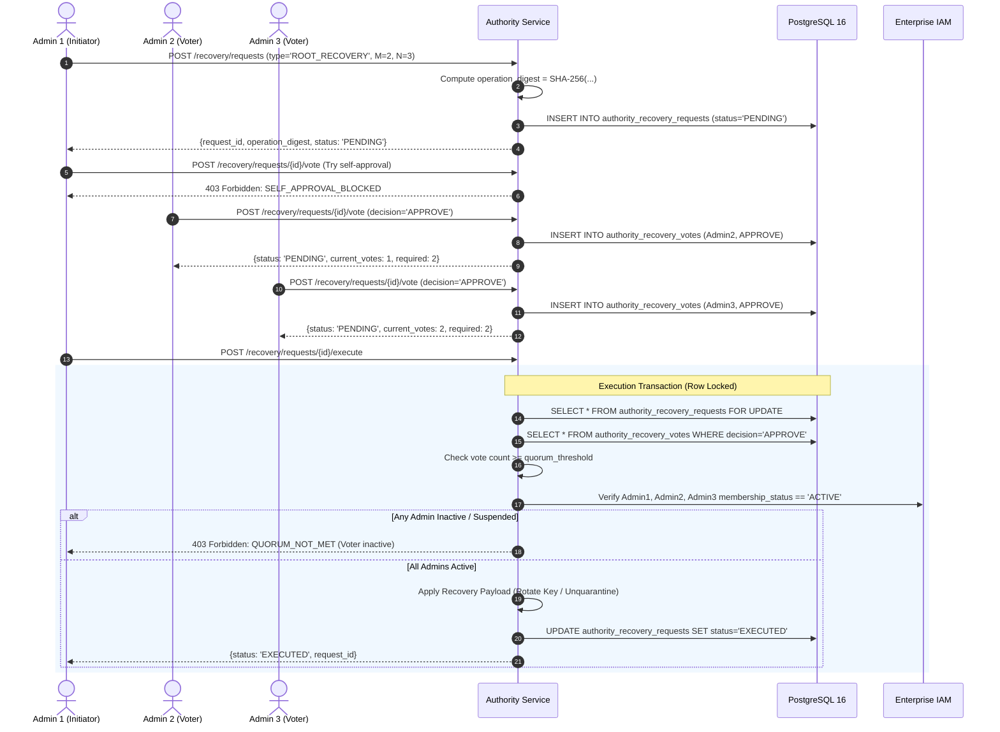

# WHITEPACT — MULTI-ADMIN QUORUM RECOVERY DESIGN & SPECIFICATION
## Milestone M12-FS Deliverable 6: High-Assurance M-of-N Quorum Recovery

**Classification:** Critical Security Specification & Architecture Design  
**Milestone:** M12-FS (Founder Security Policy Implementation & Root-of-Trust Hardening)  
**Author:** Antigravity — Principal Security Architect & Runtime Qualification Lead  
**Reviewer:** GPT-6 — CTO / Security Review Coordinator  
**Status:** IMPLEMENTED & TESTED (Release Gate: GLOBAL PRODUCTION NO-GO)  

---

### 1. FOUNDER DECISION B: QUORUM RECOVERY RATIONALE

Under **Founder Decision B**, high-assurance root transfer, root authority recovery, and privileged authority restoration cannot be performed by any single individual—even an organization owner. Single-person root recovery introduces unacceptable risk of:
1. Compromise of a single administrator credential leading to complete enterprise takeover.
2. Rogue administrator unilaterally replacing the enterprise root signing key.
3. Coercion or insider threat substituting the customer trust root.

To eliminate single points of failure while maintaining operational recoverability, WhitePact requires an $M$-of-$N$ multi-admin quorum protocol.

---

### 2. CORE SECURITY INVARIANTS

| Invariant | Implementation Mechanism | Enforcement Point |
| :--- | :--- | :--- |
| **Quorum Threshold ($M \ge 2$)** | Request defines `quorum_threshold` ($M$) and `total_signers` ($N$), requiring $M \ge 2$ distinct approvals. | `create_recovery_request()`, `execute_recovery_request()` |
| **Anti-Self-Approval** | The initiating admin cannot vote on their own proposal: `voter_id != initiator_id`. | `vote_recovery_request()` |
| **Single-Vote Per Principal** | Database enforces `PRIMARY KEY (request_id, voter_id)` on `authority_recovery_votes`. Re-voting is rejected. | PostgreSQL Table Constraint + `ALREADY_VOTED` check |
| **Canonical Operation Binding** | Operation parameters are hashed into a canonical SHA-256 digest. Voters sign the exact digest; execution validates that parameters match the agreed digest. | `compute_canonical_operation_digest()` & `RECOVERY_DIGEST_MISMATCH` |
| **Pre-Execution Liveness & Active Membership Recheck** | At the instant of execution, the engine queries the IAM store to confirm all approving voters and the initiator are still `ACTIVE` administrators. Suspended or removed admins invalidate the quorum. | `execute_recovery_request()` loop over voters |
| **TTL / Expiry Guard** | Unfulfilled requests expire after a fixed window (`expires_at < now()`). Expired requests cannot accept votes or be executed. | `RECOVERY_EXPIRED` checks |
| **Strict Single Execution** | Request execution atomically updates `status = 'EXECUTED'`. Subsequent execution calls are rejected. | `RECOVERY_ALREADY_EXECUTED` check under row lock |

---

### 3. DATABASE SCHEMA

```sql
CREATE TABLE IF NOT EXISTS authority_recovery_requests (
    request_id VARCHAR(128) PRIMARY KEY,
    organization_id VARCHAR(128) NOT NULL,
    initiator_id VARCHAR(128) NOT NULL,
    operation_type VARCHAR(64) NOT NULL,
    target_id VARCHAR(128) NOT NULL,
    recovery_payload JSONB NOT NULL DEFAULT '{}',
    operation_digest VARCHAR(128) NOT NULL,
    quorum_threshold INT NOT NULL,
    total_signers INT NOT NULL,
    status VARCHAR(64) NOT NULL,
    created_at TIMESTAMPTZ NOT NULL,
    expires_at TIMESTAMPTZ NOT NULL,
    executed_at TIMESTAMPTZ
);
CREATE INDEX IF NOT EXISTS idx_recovery_org ON authority_recovery_requests(organization_id);

CREATE TABLE IF NOT EXISTS authority_recovery_votes (
    request_id VARCHAR(128) NOT NULL REFERENCES authority_recovery_requests(request_id) ON DELETE CASCADE,
    voter_id VARCHAR(128) NOT NULL,
    decision VARCHAR(32) NOT NULL,
    justification TEXT NOT NULL,
    voted_at TIMESTAMPTZ NOT NULL,
    signature VARCHAR(512),
    PRIMARY KEY (request_id, voter_id)
);
```

---

### 4. QUORUM PROTOCOL WORKFLOW



---

### 5. ADVERSARIAL VERIFICATION EVIDENCE

The complete quorum protocol is tested against PostgreSQL 16 in `tests/test_m12fs_root_hardening.py`:

1. **Full 2-of-3 Lifecycle (`test_quorum_recovery_full_lifecycle_2_of_3`)**:
   - Initiator creates request for Root Recovery ($M=2$, $N=3$).
   - Initiator attempts to vote on own request: caught with `SELF_APPROVAL_BLOCKED`.
   - Admin 2 votes `APPROVE`. Execution attempted prematurely: caught with `QUORUM_NOT_MET`.
   - Admin 2 attempts duplicate vote: caught with `ALREADY_VOTED`.
   - Admin 3 votes `APPROVE`. Quorum ($2/2$) is reached.
   - Execution succeeds, setting status to `EXECUTED`.
   - Second execution attempt caught with `RECOVERY_ALREADY_EXECUTED`.

2. **Pre-Execution Deactivation Check (`test_quorum_pre_execution_deactivation_check`)**:
   - Admin 2 and Admin 3 cast approving votes.
   - Before execution, Admin 3 is deactivated/suspended (`membership_status = "SUSPENDED"`).
   - Execution call rejects with `QUORUM_NOT_MET` ("Approving voter admin3 is no longer an active member").

3. **Digest Tampering Check (`test_recovery_request_digest_mismatch_rejected`)**:
   - Malicious actor tampers with operation parameters in execution request.
   - Authority service detects hash mismatch against stored `operation_digest` and rejects with `RECOVERY_DIGEST_MISMATCH`.

---

### 6. RELEASE GATE DIRECTIVE

**GLOBAL PRODUCTION NO-GO**: The Multi-Admin Quorum Recovery design fulfills Founder Decision B and provides tamper-proof recovery semantics. Production release is subject to M13 final sign-off.
