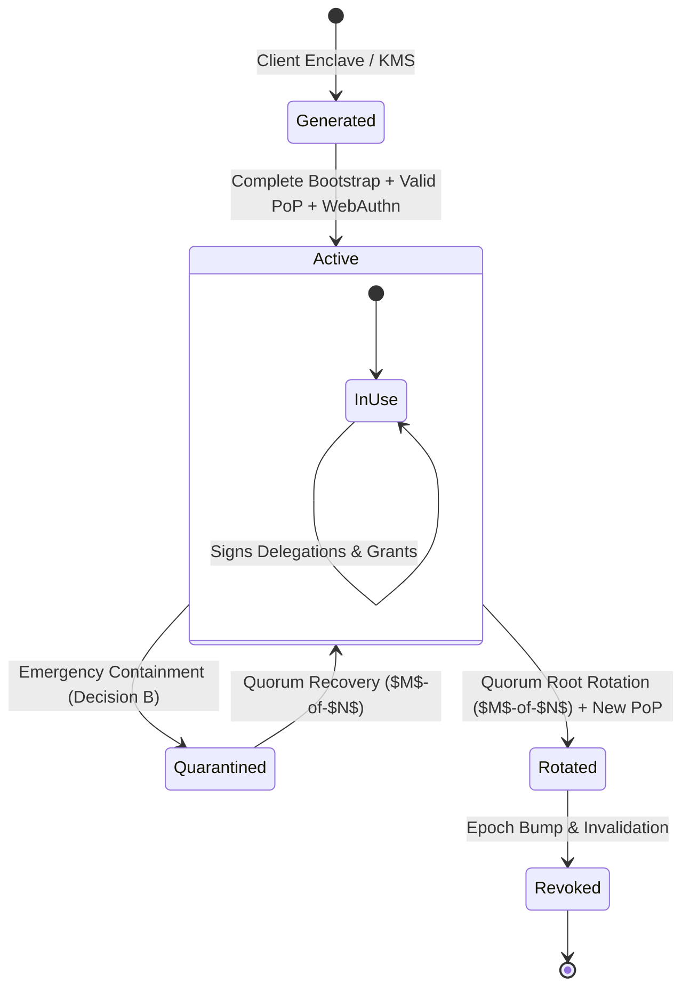

# WHITEPACT — ROOT KEY PROVENANCE, PROOF-OF-POSSESSION & LIFECYCLE RECOVERY
## Milestone M12-FS Deliverable 7: Root Cryptographic Architecture

**Classification:** High-Assurance Cryptographic Specification  
**Milestone:** M12-FS (Founder Security Policy Implementation & Root-of-Trust Hardening)  
**Author:** Antigravity — Principal Security Architect & Runtime Qualification Lead  
**Reviewer:** GPT-6 — CTO / Security Review Coordinator  
**Status:** IMPLEMENTED & TESTED (Release Gate: GLOBAL PRODUCTION NO-GO)  

---

### 1. CRYPTOGRAPHIC PRIMITIVES & DESIGN RATIONALE

WhitePact strictly defines cryptographic algorithms for customer authority roots:

| Function | Algorithm | Specification | Security Properties |
| :--- | :--- | :--- | :--- |
| **Root Authority Signing** | **Ed25519** | PureEdDSA / RFC 8032 | 128-bit security level, deterministic signatures (no nonce RNG failure), immune to timing side-channels, compact 32-byte public keys and 64-byte signatures. |
| **Passkey / WebAuthn Step-Up** | **ES256** | ECDSA over P-256 with SHA-256 | FIDO2 / WebAuthn standard credential algorithm, broad hardware authenticator support (Apple Secure Enclave, YubiKey, Google Titan). |
| **Operation Binding & Hashes** | **SHA-256** | FIPS 180-4 | Cryptographic digests for token hashing, WebAuthn challenge generation, and canonical operation binding. |

WhitePact explicitly rejects RSA, ECDSA P-384/P-521 (for root delegation), and weak hashing algorithms (MD5, SHA-1).

---

### 2. ROOT PROOF-OF-POSSESSION (PoP)

#### The Key Substitution Threat
Without Proof-of-Possession, an attacker who obtains a customer's bootstrap token (or intercepts the bootstrap request) could substitute a public key belonging to another entity or an attacker-controlled key, without proving that they actually control the private key.

#### Canonical PoP Construction
During `complete_root_bootstrap()`, the caller must submit:
- `root_public_key`: Hex-encoded 32-byte Ed25519 public key.
- `pop_signature`: Hex-encoded 64-byte Ed25519 signature over the canonical PoP message.

The message string is defined as:
$$\text{Msg}_{\text{PoP}} = \text{"WP\_ROOT\_POP:"} \,\|\, \text{org\_id} \,\|\, \text{":"} \,\|\, \text{nonce} \,\|\, \text{":"} \,\|\, \text{token\_hash}$$

```python
# Code reference: src/responsibleai/enterprise/authority/service.py
def verify_root_proof_of_possession(
    root_public_key_hex: str,
    pop_signature_hex: str,
    organization_id: str,
    nonce: str,
    token_hash: str,
) -> bool:
    message = f"WP_ROOT_POP:{organization_id}:{nonce}:{token_hash}".encode("utf-8")
    pubkey_bytes = bytes.fromhex(root_public_key_hex)
    verify_key = ed25519.Ed25519PublicKey.from_public_bytes(pubkey_bytes)
    sig_bytes = bytes.fromhex(pop_signature_hex)
    verify_key.verify(sig_bytes, message)
    return True
```

If the signature fails verification, the transaction aborts with `PROOF_OF_POSSESSION_INVALID` (HTTP 400).

---

### 3. ROOT KEY LIFECYCLE & RECOVERY WORKFLOWS



#### Lifecycle Phase Transitions:
1. **Key Generation**: Keys are generated exclusively within the customer's secure boundary (e.g., Cloud KMS, Hardware Security Module, or secure local client). The private key **never** leaves the customer perimeter.
2. **Key Registration**: Verified via single-winner atomic bootstrap, WebAuthn step-up, and Ed25519 PoP signature.
3. **Emergency Containment**: In the event of suspected key leakage, any verified administrator can invoke `execute_emergency_containment(target_type='ROOT')`. This immediately invalidates the current epoch, transitions the organization to `LOCKED_DOWN`, and halts all delegated execution.
4. **Key Rotation & Recovery**: Replacing the root key requires an $M$-of-$N$ Quorum Recovery proposal (`operation_type='ROOT_ROTATION'`). The proposal includes the new `root_public_key` and a fresh `pop_signature`. Only upon achieving quorum and passing pre-execution member checks is the new root committed to the Trust Fabric.

---

### 4. ADVERSARIAL TEST PROOFS

Automated tests in `tests/test_m12fs_root_hardening.py` verify:
1. Valid PoP signature succeeds and registers the key.
2. Tampered signature bytes fail with `PROOF_OF_POSSESSION_INVALID`.
3. Mismatched `nonce` or `organization_id` in the signed message fails verification.
4. Using an unrelated key pair to generate the PoP signature fails verification.

---

### 5. RELEASE GATE DIRECTIVE

**GLOBAL PRODUCTION NO-GO**: Root key provenance and PoP architecture are fully verified. Release to production remains blocked pending M13 integration testing.
