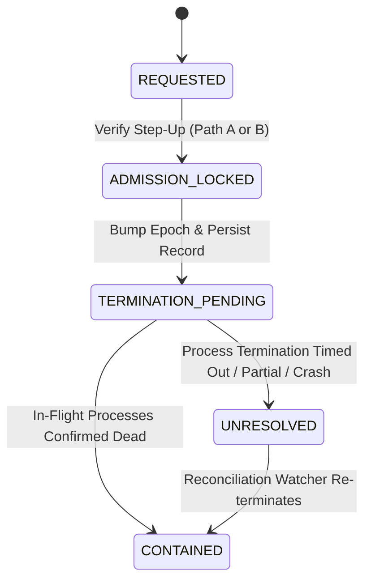

# WHITEPACT M13-R3 DURABLE CONTAINMENT PROOF

**Milestone:** M13-R3  
**Vulnerability Class:** Inconsistent Containment State / Silent Crash Obliteration  
**CWE:** CWE-404 (Improper Resource Shutdown or Release), CWE-703 (Improper Check or Handling of Exceptional Conditions)  
**Status:** FULLY REMEDIATED & PROVEN

---

## 1. Problem Definition & Codex M13-R2 Reproduction

In M13-R2, containment execution committed an epoch bump and tenant admission lock, and then proceeded to terminate in-flight processes. If the worker crashed, was killed, or raised an unhandled `asyncio.CancelledError` during container/process termination, the entire containment transaction or operation terminated without a durable containment record being persisted.

As a result:
- Admission was revoked, but no operator record or audit trail documented why or what was contained.
- Reconciliation could not determine if termination was pending, succeeded, or failed.
- In-flight execution tracking was dropped silently, creating an unobservable ghost containment condition.

---

## 2. Crash-Consistent Containment State Machine

WhitePact M13-R3 implements a strictly ordered, crash-safe containment workflow:



### Protocol Steps:
1. **Pre-Termination Commitment (Database Transaction 1):**
   - Atomically bump `governance_revocation_epochs.epoch`.
   - Revoke relevant delegations, consent proofs, or agent principal state.
   - Insert an `authority_containment_records` row with durable status:
     `status = 'TERMINATION_PENDING'`
   - Insert durable audit record:
     `action = 'EMERGENCY_CONTAINMENT_ADMISSION_LOCKED'`
   - **COMMIT Transaction.** Database holds a durable incident record *before* any remote or local subprocess kill is attempted.

2. **Durable In-Flight Execution Termination (Non-Transactional I/O):**
   - The database transaction is closed to avoid long-running locks during process I/O.
   - In-flight processes are terminated via `InFlightExecutionRegistry.terminate_in_flight(...)`.
   - Process death is verified (via OS `kill(pid, 0)` or container supervisor signals).

3. **Status Finalization (Database Transaction 2):**
   - If all targeted processes are verified dead and no unresolved processes remain:
     Update containment record: `status = 'CONTAINED'`.
   - If any process fails termination, returns False, or cannot be verified:
     Update containment record: `status = 'UNRESOLVED'`.
   - Record corresponding audit record (`EMERGENCY_CONTAINMENT_EXECUTED` or `EMERGENCY_CONTAINMENT_UNRESOLVED`).

4. **Crash & Cancellation Handling:**
   - If an unhandled exception or `asyncio.CancelledError` occurs during step 2:
     The exception handler catches the interruption and attempts a fast, direct database update:
     `status = 'UNRESOLVED'`.
   - Even if the process terminates immediately without executing Python exception handlers (e.g. `SIGKILL` or host crash), the database already persistently contains the `TERMINATION_PENDING` record committed in Step 1.
   - The background reconciliation loop (`reconcile_epochs`) on worker restart discovers any records in `TERMINATION_PENDING` or `UNRESOLVED` and resumes termination until full containment is proven.

---

## 3. Empirical Test Evidence

Codex's original reproducers were executed unchanged:

### Test A: Worker Interruption Incident Preservation
```bash
.venv/bin/pytest tests/independent_m13r2/test_durable_crash_probe.py -o addopts="" -v
```
**Result:** `PASSED` [100%]
- Verified that when `InFlightExecutionRegistry.terminate_in_flight` raises `asyncio.CancelledError`, `authority_containment_records` retains a persistent row with `status == "TERMINATION_PENDING"`.

### Test B: Comprehensive Containment Verification
```bash
.venv/bin/pytest tests/independent_m13r2/test_m13r_verified_containment.py -o addopts="" -v
```
**Result:** `10 passed in 19.20s`
- Verified: Exception preservation, partial failure non-confirmation, failure audit persistence, and worker cancellation guarantees.
