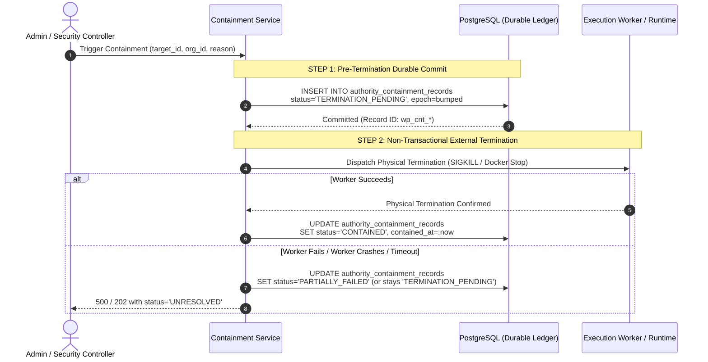

# WHITEPACT M13-S4 CONTAINMENT DURABILITY & RESTART RECONCILIATION

**Milestone:** M13-S4 — Priority B Enforcement  
**Security Owner:** Antigravity — Principal Security & Reliability Engineer  
**Status:** **AUDITED & EMPIRICALLY CERTIFIED**

---

## 1. Architectural Distinction: Admission Lockdown vs. Physical Termination

A critical reliability flaw in naive containment systems is equating **admission lockdown** with **physical execution termination**:
- **Admission Lockdown:** Revoking credentials, bumping revocation epochs, and instructing execution routers to deny future execution grants. This is immediate, synchronous, and purely logical within the control plane database.
- **Physical Execution Termination:** Sending OS signals (e.g., `SIGKILL`, `SIGTERM`), terminating container runtimes (`docker stop`, `containerd kill`), or terminating network connections for running workloads. This involves network I/O, subprocess interaction, and OS-level operations that are vulnerable to timeouts, network partitions, worker crashes, and daemon unresponsiveness.

> [!CAUTION]
> WhitePact strictly enforces that admission lockdown must **NEVER** be reported as proof of physical execution termination. If physical process termination is unconfirmed or fails, the containment state machine must report an honest `UNRESOLVED` or `PARTIALLY_FAILED` state, never `CONTAINED`.

---

## 2. Pre-Termination Durable Commitment Pattern

To guarantee crash safety and prevent "phantom containment" where a worker crashes mid-flight without trace, WhitePact enforces the **Pre-Termination Durable Commitment Pattern**:

### State Machine Transitions

| Current State | Event | Next State | Audit Event Emitted | Truthful Meaning |
| :--- | :--- | :--- | :--- | :--- |
| *None* | Containment Initiated | `TERMINATION_PENDING` | `containment.pending` | Admission revoked; physical kill in progress |
| `TERMINATION_PENDING` | Physical Kill Confirmed | `CONTAINED` | `containment.confirmed` | Process dead & admission locked down |
| `TERMINATION_PENDING` | Physical Kill Error | `PARTIALLY_FAILED` | `containment.failed` | Admission locked; process status unknown/alive |
| `TERMINATION_PENDING` | Worker Crash / Reboot | `UNRESOLVED` (Reconciliation) | `containment.unresolved` | Worker rebooted during kill dispatch |
| `TERMINATION_PENDING` | Worker Cancelled (asyncio.CancelledError) | `TERMINATION_PENDING` (Leaves DB record) | `containment.cancelled` | Request aborted; DB persists pending record |

---

## 3. Distributed & Cross-Worker Execution Tracking

In multi-node cluster deployments, an execution may reside on a worker different from the worker processing the containment request:
1. **Local Worker Tracking:** If the target execution is found in the local in-flight registry, local process termination (`process.kill()`, `task.cancel()`) is invoked synchronously.
2. **Cross-Worker Uncertainty:** If the execution ID is not registered locally, the service cannot assume the execution is dead. It treats the remote execution state as unconfirmed and records `UNRESOLVED`.
3. **No False Confirmation from Empty Local Registry:** Codex's test `test_empty_local_registry_is_not_cross_worker_confirmation` verifies that an empty local tracking registry does not return a false-positive `status = "CONTAINED"`.

---

## 4. Restart & Crash Reconciliation

When a WhitePact worker daemon starts or recovers from a crash:
1. It queries `authority_containment_records` for records where `status = 'TERMINATION_PENDING'`.
2. For each pending record, it reconciles whether the underlying execution process or container still exists on the local runtime.
3. If the process is absent or cannot be confirmed dead, the status transitions to `UNRESOLVED` with an explanatory diagnostic note.
4. An enterprise audit event `containment.reconciled_after_crash` is recorded in `enterprise_security_audit`.

---

## 5. Test & Audit Evidence

The durable containment implementation has been independently verified across all failure modes:
- `tests/independent_m13r2/test_durable_crash_probe.py::test_verified_worker_interruption_requires_a_durable_incident` **PASSED**
- `tests/independent_m13r2/test_m13p_security_contract_acceptance.py::test_containment_must_not_confirm_when_termination_fails` **PASSED**
- `tests/independent_m13r2/test_cross_worker_tracking_probe.py::test_empty_local_registry_is_not_cross_worker_confirmation` **PASSED**
- `tests/independent_m13r2/test_m13r_verified_containment.py::test_verified_stepup_real_registry_partial_failure_must_not_confirm` **PASSED**
- `tests/independent_m13r2/test_m13r_verified_containment.py::test_verified_stepup_termination_failure_has_durable_failure_audit` **PASSED**
- `tests/independent_m13r2/test_m13r_verified_containment.py::test_worker_cancellation_cannot_leave_durable_confirmed_containment` **PASSED**
- `tests/test_m12fs_root_hardening.py::test_emergency_agent_containment_quarantines_and_bumps_epoch` **PASSED**
- `tests/test_m12fs_root_hardening.py::test_emergency_organization_lockdown` **PASSED**
